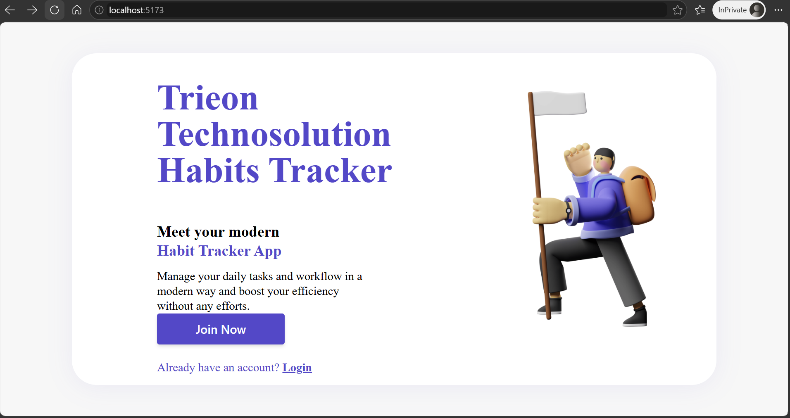
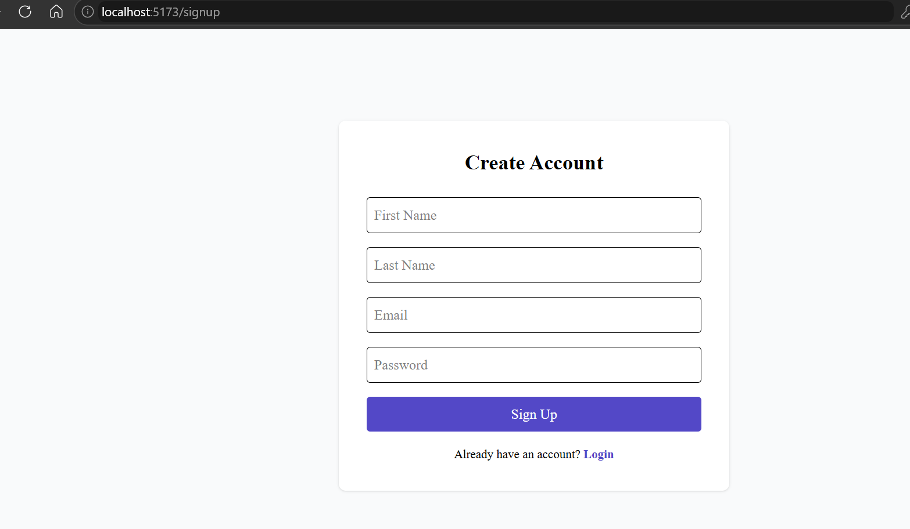
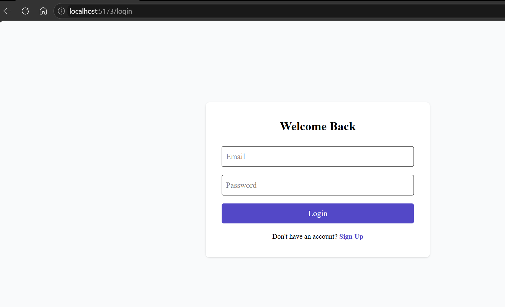
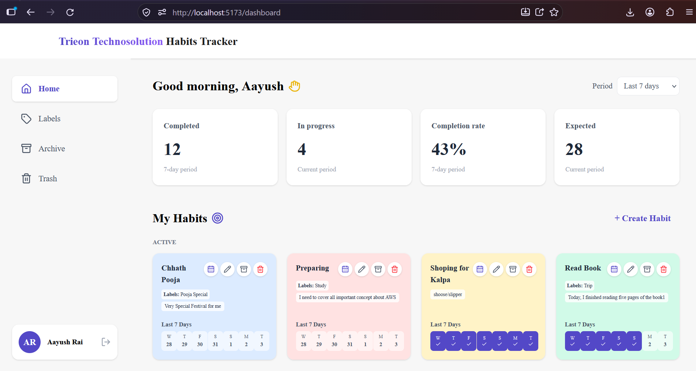
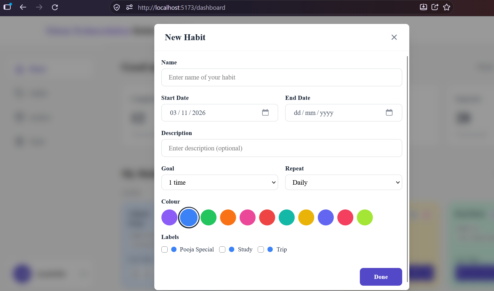

# Habit Tracker

A full-stack habit tracker built with React, Node.js, Express, and SQLite.

**Track:** Full-stack

## Demo
Landing page


Signup page 


Login page


Dashboard


Habit Modal


## Features

- Authentication (Signup / Login / Logout) with JWT & bcrypt
- Create, edit, archive, trash, restore, and permanently delete habits
- Mark habits complete for a date, undo completion
- 7-day mini calendar inside each habit card
- Duplicate completions prevented at the database level
- Custom labels (Health, Study, Work, etc.)
- Dashboard stats: Completed, In Progress, Overdue, Total
- Dark mode toggle
- Protected routes (frontend & backend)
- Per-user data isolation (IDOR protection)

## Tech Stack

- **Frontend:** React, Vite, Tailwind CSS, React Router, Axios, Lucide Icons
- **Backend:** Node.js, Express, SQLite3
- **Auth:** JWT + bcryptjs

## Setup

### Backend
```bash
cd backend
npm install
```

## How to Test

1. Sign up with a new user.
2. Create 2–3 labels from the **Labels** page.
3. Create a habit and assign one or more labels.
4. Click dates on the mini calendar to mark the habit complete or undo a completion.
5. Move a habit to **Archive** or **Trash**, then try restoring it.
6. Check that the stats update on the dashboard.
